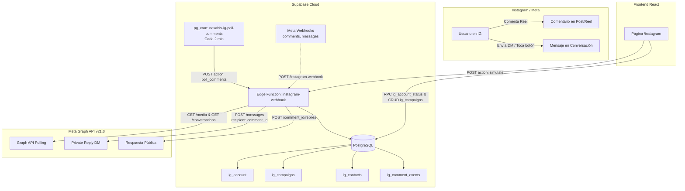

# 📱 Instagram Auto-DM (Comment-to-DM) - Nexabis System Reference

> **Documento maestro para Claude y desarrolladores.**  
> Contiene toda la arquitectura, decisiones de diseño, esquemas de base de datos, particularidades de la Graph API de Meta, crons, Edge Functions y oportunidades de mejora del sistema nativo de Instagram Comment-to-DM (sin ManyChat).

---

## 🧭 1. Resumen Ejecutivo y Objetivo

El objetivo de esta integración es reemplazar plataformas externas como **ManyChat** por una solución **100% nativa, sin costo recurrente y con soberanía de datos** en el ecosistema Nexabis:
- **Disparador:** Un usuario de Instagram comenta un Reel o publicación con palabras clave objetivo (ej. `info`, `sistema`, `nexabot`, `precio`, `cotizar`).
- **Respuesta Privada (Private Reply):** El sistema envía automáticamente un mensaje directo (DM) con la oferta y el enlace de acceso (`https://nexabistech.com`).
- **Respuesta Pública:** El sistema responde al comentario del usuario confirmando la entrega del DM (ej. *"¡Te escribí por mensaje directo, @usuario! 📩"*).
- **Control Central:** Panel de control completo en la aplicación web (`/instagram`), con métricas en tiempo real, editor de campañas, selector visual de Reels y simulador de pruebas.

---

## 🏗️ 2. Arquitectura del Sistema



---

## 🔑 3. Credenciales e Identificadores del Entorno

| Parámetro | Valor / Identificador | Notas |
| :--- | :--- | :--- |
| **Supabase Project ID** | `htwuamsbzaznmwuypflt` | `https://htwuamsbzaznmwuypflt.supabase.co` |
| **Meta App Name** | `Nexabis Technologies` | Aplicación registrada en Meta for Developers |
| **Meta App ID** | `1508603997825384` | |
| **Meta App Secret** | Secret en Supabase (`IG_APP_SECRET`) | Configurado en Supabase Edge Functions Secrets |
| **Webhook Verify Token** | Secret `IG_VERIFY_TOKEN` (no se versiona) | Configurado en Meta Webhook e `IG_VERIFY_TOKEN` |
| **Admin Secret Key** | Secret `IG_ADMIN_KEY` + Vault `ig_admin_key` (no se versiona) | Header `x-ig-admin-key` para llamadas administrativas |
| **Cuenta IG Conectada** | `@cris.nexabis` | ID de Instagram Business: `17841479705225488` |
| **Facebook Page Vinculada**| `Cris Automatización, DEV & IA`| Page ID: `1447803525077923` |
| **Cuenta de Pruebas** | `@cris.abarca_` | ID de usuario IG: `2037419400522219` |
| **URL del Webhook** | `https://htwuamsbzaznmwuypflt.supabase.co/functions/v1/instagram-webhook` | Desplegado con flag `--no-verify-jwt` |

---

## 🗄️ 4. Esquema de Base de Datos (PostgreSQL)

El archivo de migración principal se encuentra en:
`supabase/migrations/20261030_01_instagram_comment_to_dm.sql`
El cron de polling se encuentra en:
`supabase/migrations/20261101_01_instagram_poll_cron.sql`

### 4.1. Tabla `public.ig_account`
Almacena el token y estado de la cuenta conectada. **Protegida por RLS:** ningún rol anónimo o cliente puede leer tokens.
```sql
CREATE TABLE public.ig_account (
  id uuid PRIMARY KEY DEFAULT gen_random_uuid(),
  ig_user_id text NOT NULL UNIQUE,
  username text,
  access_token text NOT NULL,
  token_expires_at timestamptz,
  webhook_subscribed boolean DEFAULT false,
  raw_profile jsonb,
  updated_at timestamptz DEFAULT now()
);
```

### 4.2. Tabla `public.ig_campaigns`
Define las reglas de automatización por palabras clave y publicaciones:
```sql
CREATE TABLE public.ig_campaigns (
  id uuid PRIMARY KEY DEFAULT gen_random_uuid(),
  nombre text NOT NULL,
  activa boolean DEFAULT true,
  prioridad int DEFAULT 0,
  keywords text[] DEFAULT '{}',
  match_mode text DEFAULT 'contiene', -- 'contiene' | 'exacta' | 'cualquiera'
  media_ids text[] DEFAULT '{}',      -- Vacío = aplica a todos los posts/reels
  responder_dm boolean DEFAULT false,  -- Si también responde palabras clave en DM directo
  modo text DEFAULT 'directo',        -- 'directo' (link en 1er DM) | 'dos_pasos' (botón interactivo)
  mensaje_inicial text,               -- Primer DM en modo dos_pasos
  boton_texto text DEFAULT 'Sí, envíamela', -- Botón del primer DM (máx 20 chars)
  mensaje_oferta text NOT NULL,       -- Mensaje con la oferta/link
  link_url text,                      -- URL del producto/landing (https://nexabistech.com)
  link_titulo text DEFAULT 'Ver oferta',
  respuestas_publicas text[] DEFAULT '{}', -- Comentarios públicos aleatorios
  delay_segundos int DEFAULT 0,       -- Pausa humana antes de responder (0-60s)
  una_vez_por_usuario boolean DEFAULT false, -- Limitar a 1 DM por usuario en la campaña
  created_at timestamptz DEFAULT now(),
  updated_at timestamptz DEFAULT now()
);
```

### 4.3. Tabla `public.ig_contacts`
Libreta de leads e historial de interacciones:
```sql
CREATE TABLE public.ig_contacts (
  ig_user_id text PRIMARY KEY,
  username text,
  primer_contacto timestamptz DEFAULT now(),
  ultimo_contacto timestamptz DEFAULT now(),
  total_comentarios int DEFAULT 1,
  pending_campaign_id uuid REFERENCES public.ig_campaigns(id),
  pending_until timestamptz,
  oferta_enviada_at timestamptz,
  ultima_campaign_id uuid REFERENCES public.ig_campaigns(id),
  notas text
);
```

### 4.4. Tabla `public.ig_comment_events` (Garantía de Idempotencia)
Registra cada comentario individual. **Tiene una restricción `UNIQUE (comment_id)`:**
```sql
CREATE TABLE public.ig_comment_events (
  id bigserial PRIMARY KEY,
  comment_id text NOT NULL UNIQUE,     -- Constraint UNIQUE garantiza que jamás se duplique
  media_id text,
  media_type text,
  parent_id text,
  from_id text NOT NULL,
  from_username text,
  texto text,
  campaign_id uuid REFERENCES public.ig_campaigns(id),
  estado text NOT NULL CHECK (estado IN ('recibido', 'enviado', 'omitido', 'error')),
  motivo text,
  private_reply_ok boolean,
  public_reply_ok boolean,
  oferta_enviada_at timestamptz,
  created_at timestamptz DEFAULT now()
);
```

---

## ⚡ 5. Edge Function: `instagram-webhook`

Ubicación: [`supabase/functions/instagram-webhook/index.ts`](file:///C:/Users/craba/OneDrive/Desktop/Personal/Proyectos/nexabis-quote-forge-74920/supabase/functions/instagram-webhook/index.ts)

### 5.1. Puntos de Entrada
1. **`GET /` (Meta Webhook Handshake):** Valida `hub.mode === "subscribe"` y `hub.verify_token === IG_VERIFY_TOKEN`. Responde con `hub.challenge`.
2. **`POST /` con firma `x-hub-signature-256`:** Procesa webhooks en tiempo real cuando Meta los despacha.
3. **`POST /` con `action`: Acciones administrativas y crons:**
   - `action: "poll_comments"`: Ejecutado por `pg_cron` cada 2 minutos.
   - `action: "refresh_token"`: Ejecutado semanalmente para extender el token de Meta.
   - `action: "connect"`: Vincula o actualiza el token de acceso desde el frontend.
   - `action: "simulate"`: Ejecuta una simulación local sin tocar la API de Meta.
   - `action: "list_media"`: Lista los últimos 24 Reels y publicaciones para el selector visual.

---

## ⚠️ 6. Hallazgos Críticos y Reglas de Meta Graph API (Lecciones Aprendidas)

> [!IMPORTANT]
> Estas reglas fueron verificadas empíricamente contra la API de Meta y resuelven errores comunes:

### 6.1. Dominio y Tipo de Token (`graph.facebook.com` vs `graph.instagram.com`)
* Cuentas de Instagram Business vinculadas a una Página de Facebook utilizan un **Page Access Token** (prefijo `EAAV...`).
* **Regla:** Si el token empieza por `EAA`, las peticiones **DEBEN** hacerse a `https://graph.facebook.com/v21.0/`. Intentar consultar `graph.instagram.com` con un token `EAA` devolverá un error de autorización. La Edge Function detecta automáticamente el prefijo y selecciona la URL base correcta.

### 6.2. Política de Respuestas Privadas (Private Reply)
* **Endpoint:** `POST /{ig_user_id}/messages` con `recipient: { "comment_id": "<ID_COMENTARIO>" }`.
* **Ventana de 7 días:** Meta **solo** permite enviar una respuesta privada si el comentario fue creado hace menos de 7 días. Comentarios más antiguos fallan con el error:  
  `(-1) Según la política de respuestas privadas, el comentario es demasiado antiguo para recibir una respuesta.`
* **Prohibición de Templates con Botones URL en Private Replies:**  
  Meta **rechaza** mensajes interactivos (`template: generic` con `web_url` buttons) en respuestas directas a comentarios con el error:  
  `(#100) Param recipient[comment_id] must not be used with template messages`.  
  **Solución:** Se envía texto enriquecido con el link en plano (`https://nexabistech.com`), el cual Instagram renderiza automáticamente como un enlace interactivo cliqueable en el DM.

### 6.3. Respuestas Públicas a Comentarios
* **Endpoint:** `POST /{comment_id}/replies?message=<TEXTO>`.
* Funciona con el Page Access Token. Ayuda a mejorar el engagement del algoritmo de Instagram (más comentarios totales) e informa al usuario que revise su bandeja de entrada.

### 6.4. Entorno de Desarrollo vs Polling de Crons
* Mientras la aplicación en Meta esté en modo de desarrollo o en proceso de verificación (*App Review* para permisos `instagram_business_manage_comments` e `instagram_business_manage_messages`), **Meta suprime los webhooks en tiempo real** de usuarios no testeadores.
* **Solución de alta resiliencia:**  
  Un cron en Supabase (`pg_cron`) invoca la Edge Function cada 2 minutos (`action: "poll_comments"`).  
  El sondeo no solo revisa `/{ig_user_id}/media?fields=comments`, sino que también consulta `/{ig_user_id}/conversations?platform=instagram` para capturar respuestas en DM de inmediato.

---

## 🛡️ 7. Mecanismo Anti-Duplicados (Doble Capa de Idempotencia)

Para responder a la exigencia de que un comentario se procese **estrictamente una sola vez**:

1. **Capa 1: Filtro en Memoria / SQL antes de llamar a Meta**
   ```typescript
   // En actionPollComments:
   const { count } = await db
     .from("ig_comment_events")
     .select("id", { count: "exact", head: true })
     .eq("comment_id", commentId);

   if ((count ?? 0) > 0) continue; // Si ya existe en la tabla, se salta inmediatamente
   ```
2. **Capa 2: Constraint UNIQUE en PostgreSQL**
   ```sql
   ALTER TABLE public.ig_comment_events ADD CONSTRAINT ig_comment_events_comment_id_key UNIQUE (comment_id);
   ```
   Si dos llamadas del cron ocurren en el mismo milisegundo, la base de datos aborta con el código `23505` (violación de unicidad), evitando cualquier duplicado de mensaje.

---

## 🎯 8. Modos de Campaña: ¿Directo o Dos Pasos?

### Modo Directo (`modo: "directo"`) - *Configuración Actual*
* **Flujo:** Comentario `nexabot` -> 1 DM directo con el mensaje completo y el enlace `https://nexabistech.com` + 1 respuesta pública en el comentario.
* **Ventajas:** Máxima conversión, cero fricción, ideal para el lanzamiento del video. El usuario no tiene que presionar ningún botón adicional para recibir su enlace.

### Modo Dos Pasos (`modo: "dos_pasos"`)
* **Flujo:** Comentario `nexabot` -> 1 DM con botón de respuesta rápida (*"Sí, envíamela 🚀"*) -> Usuario pulsa botón -> 2do DM con la oferta.
* **Ventajas:** Abre la ventana oficial de 24h de Meta Messaging.
* **Consideración:** Requiere que el polling de conversaciones o el webhook de mensajes capture la respuesta del usuario.

---

## 🖥️ 9. Frontend: Panel de Control en `/instagram`

Ubicación del código: [`src/pages/Instagram.tsx`](file:///C:/Users/craba/OneDrive/Desktop/Personal/Proyectos/nexabis-quote-forge-74920/src/pages/Instagram.tsx)
Ruta en la app: `http://localhost:8080/instagram`

### Características de la Interfaz:
1. **Tarjeta de Conexión:** Muestra estado de la cuenta (`@cris.nexabis`), días restantes del token y botón para re-suscribir webhooks.
2. **Tarjetas de Estadísticas:**
   - Comentarios totales recibidos.
   - Mensajes directos enviados.
   - Ofertas entregadas.
   - Tasa de conversión (% de ofertas respecto a comentarios).
   - Errores de API.
3. **Editor de Campañas:**
   - Palabras clave y tipo de coincidencia (*contiene*, *exacta*, *cualquiera*).
   - Selector visual de Reels y Posts (con miniaturas reales traídas de la API).
   - Conmutador entre Modo Directo y Modo Dos Pasos.
   - Variables dinámicas `{username}` y `{link}` en los textos.
   - Respuestas públicas aleatorias (una por línea).
   - Selector de retraso artificial (0 a 60 segundos).
   - Toggle para limitar a 1 DM por usuario.
4. **Simulador en Vivo:** Permite simular un comentario y ver el mensaje exacto que saldría antes de guardarlo.
5. **Tabla de Historial:** Lista en tiempo real cada comentario procesado con su estado, fecha, usuario y resultado.

---

## 🧩 9.5. Versión 2 (2026-11-01): Embudo, CRM, UTM y Nexabot IA

Migraciones: `20261101_02_instagram_growth.sql` (esquema) y `20261101_03_instagram_cron_auth.sql` (crons con clave desde Vault).

> [!WARNING]
> **Hallazgo 2026-11-01:** en modo desarrollo, los DMs a usuarios que NO son testers fallan con `(#100) No se puede encontrar al usuario solicitado.` El polling detecta los comentarios, pero Meta no deja enviar. **Advanced Access (App Review) es requisito para vender a usuarios reales.**

* **`ig_settings`** (fila única, editable por el equipo): `crm_sync`, `crm_owner_id`, `ai_enabled`, `ai_prompt`, `ai_link`, `ai_max_turnos_dia`.
* **CRM:** trigger AFTER `private.ig_sync_contact_to_crm` sobre `ig_contacts.oferta_enviada_at` → crea `clientes` (`fuente='instagram'`, `etapa_ciclo='lead'`, `email=''`) + `oportunidades` en la primera etapa del pipeline del owner; guarda `ig_contacts.cliente_id`. Es AFTER a propósito: con `upsert`, un BEFORE INSERT duplicaría clientes.
* **Links:** `utm_activo` (UTM `instagram/dm/<slug campaña>/<media_id>`, excepto links de WhatsApp) y `rastrear_clics` (link `.../instagram-webhook?go=<token>` → `ig_links` + RPC `ig_register_click` → 302).
* **`ig_messages`:** historial de DMs con `mid` UNIQUE (deduplica webhook y polling y da contexto a la IA). `origen`: `usuario | campaña | ia | humano`.
* **Nexabot IA (APAGADO, sin pestaña en el panel por decisión del usuario):** solo modelos gratuitos. Si se activa (`ig_settings.ai_enabled=true`), DMs sin keyword → `aiReply()` con Gemini (`GEMINI_API_KEY`, capa gratuita). No usar APIs de pago. Se pausa 12 h si un humano responde desde Instagram (eco no registrado) y 24 h si la IA responde con `[HUMANO]`. Hay un límite diario de respuestas por persona. Acción `simulate_ai` para probar desde el panel.
* **Embudo:** RPC `ig_funnel_stats()` → comentarios, DMs, ofertas, clics, leads, presupuestos, aprobados e ingresos, más un desglose por campaña.
* **Polling:** 15 posts × 50 comentarios; descarta comentarios de más de 7 días; deduplica en lote; tiene un presupuesto de 110 s; la pausa `delay_segundos` solo se aplica en webhooks; DMs del polling de máximo 30 min de antigüedad.
* **Token:** los tokens de Página `EAA...` se validan con `debug_token` (`token_expires_at = null` si no vencen). Ya no se usa `ig_refresh_token` con ellos.
* **`poll_comments`:** es público hasta que se define `IG_POLL_REQUIRE_KEY=true` y se aplica la migración `_03`.

---

## 🚀 10. Ideas de Mejora y Futuras Extensiones

Cuando Claude o el equipo retome este sistema, estas son las extensiones recomendadas de mayor impacto:

1. **Agente IA Conversacional en DM (Nexabot):**
   - Actualmente, si el usuario hace una pregunta libre en DM (ej. *"¿Cuánto cuesta el plan empresarial?"*), el bot solo responde si calza con una palabra clave.
   - **Mejora:** Conectar los mensajes no reconocidos a una Edge Function con Gemini / Claude que actúe como agente de ventas 24/7 y agende citas o entregue presupuestos automáticos.
2. **Soporte para Menciones en Historias (Story Mentions):**
   - Suscribirse al webhook `story_insights` o `mentions` para enviar automáticamente un cupón o mensaje de agradecimiento cuando alguien mencione a `@cris.nexabis` en sus Historias de Instagram.
3. **Sincronización Directa con el CRM de Nexabis:**
   - Cuando un contacto de `ig_contacts` reciba una oferta o interactúe más de 2 veces, insertarlo automáticamente como prospecto en la tabla `clientes` del CRM en la etapa *"Contacto Inicial"*.
4. **Parámetros UTM Dinámicos en Enlaces:**
   - En lugar de enviar `https://nexabistech.com` genérico, generar enlaces como:  
     `https://nexabistech.com?utm_source=instagram&utm_medium=reel_auto_dm&utm_campaign={campaign_id}&user={username}`  
     para medir en analítica web qué campañas generan más ventas cerradas.
5. **App Review en Meta Developers:**
   - Grabar un screencast de prueba mostrando cómo funciona el bot para solicitar el acceso avanzado (*Advanced Access*) a `instagram_business_manage_comments` e `instagram_business_manage_messages`. Esto activará webhooks instantáneos de milisegundos para cualquier usuario del mundo sin depender del cron.

---

## 📋 11. Comandos Frecuentes de Mantenimiento

### Desplegar cambios en la Edge Function:
```powershell
$env:SUPABASE_ACCESS_TOKEN = "<tu token sbp_... (Supabase → Account → Access Tokens)>"
npx supabase functions deploy instagram-webhook --project-ref htwuamsbzaznmwuypflt --no-verify-jwt
```

### Ejecutar Polling Manual desde PowerShell/Node:
```powershell
node -e "fetch('https://htwuamsbzaznmwuypflt.supabase.co/functions/v1/instagram-webhook', { method: 'POST', headers: { 'content-type': 'application/json', 'x-ig-admin-key': process.env.IG_ADMIN_KEY }, body: JSON.stringify({ action: 'poll_comments' }) }).then(r=>r.json()).then(console.log)"
```

### Consultar los últimos 10 comentarios procesados en la Base de Datos:
```powershell
$env:SUPABASE_ACCESS_TOKEN = "<tu token sbp_... (Supabase → Account → Access Tokens)>"
npx supabase db query --linked "SELECT id, comment_id, from_username, texto, estado, motivo, created_at FROM public.ig_comment_events ORDER BY created_at DESC LIMIT 10;"
```
