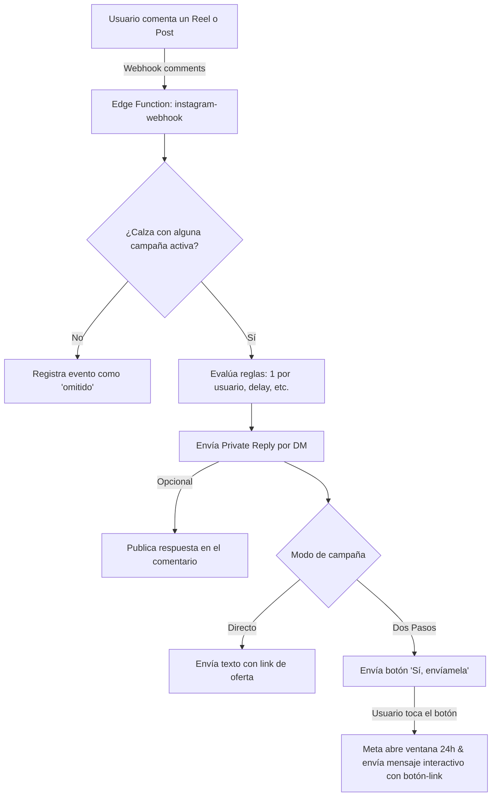

# 🚀 Guía de Configuración: Instagram Auto-DM (Sin ManyChat)

Sistema propio de **Comment-to-DM** integrado directamente en tu ecosistema Nexabis (Supabase + React + Meta Graph API).

---

## 🎯 ¿Cómo funciona?



### ¿Por qué sin ManyChat?
1. **0 costo mensual:** No pagas suscripción por volumen de contactos.
2. **Tus datos en tu base:** Todos los comentarios, usuarios de Instagram y conversiones quedan en tu tabla `ig_contacts` e `ig_comment_events`.
3. **Flujo de Dos Pasos anti-spam:** Los mensajes iniciales con enlaces directos en solicitudes de mensaje suelen ser filtrados por Instagram. Con el botón interactivo de respuesta rápida, el usuario inicia la conversación y la oferta llega a la bandeja principal con botones nativos.

---

## 🛠️ Paso a Paso para Dejarlo Operativo

### Paso 1: Ejecutar la migración SQL en Supabase
El script ya está creado en tu proyecto en:
`supabase/migrations/20261030_01_instagram_comment_to_dm.sql`

Puedes ejecutarlo desde el SQL Editor de tu Dashboard de Supabase (o por CLI si lo tienes vinculado). Crea:
- `ig_account`: almacena las credenciales de conexión de Instagram de forma segura (sin acceso RLS para clientes).
- `ig_campaigns`: tus reglas de automatización (palabras clave, publicaciones específicas, mensajes, enlaces).
- `ig_contacts`: libreta de prospectos/leads capturados desde Instagram.
- `ig_comment_events`: registro histórico e idempotente de cada comentario procesado.
- `ig_account_status()`: función RPC para consultar el estado en la interfaz sin exponer tokens.
- **Cron semanal (`pg_cron`)**: renueva automáticamente el token de larga duración de Meta cada lunes a las 09:00 UTC.

---

### Paso 2: Desplegar la Edge Function y Configurar Secrets

1. **Variables de Entorno (Secrets en Supabase):**
   Ve a tu panel de Supabase -> **Project Settings -> Edge Functions -> Secrets** y define:

   | Variable | Descripción | Ejemplo / Valor |
   | :--- | :--- | :--- |
   | `IG_APP_SECRET` | Clave secreta de tu App en Meta Developers (App Secret) | `a8b9c0d1e2f3...` |
   | `IG_VERIFY_TOKEN` | Token inventado por ti para validar el webhook con Meta | `un_texto_largo_y_aleatorio` |
   | `IG_ADMIN_KEY` | *(Opcional)* Token maestro para llamadas CLI o testing | `mi_clave_secreta` |
   | `IG_GRAPH_VERSION` | *(Opcional)* Versión de la Graph API | `v24.0` (por defecto) |

2. **Desplegar la Edge Function:**
   ```bash
   npx supabase functions deploy instagram-webhook --no-verify-jwt
   ```
   *(Nota: `--no-verify-jwt` es obligatorio porque Meta envía los webhooks sin header Bearer de Supabase).*

   La URL de tu Webhook será:
   ```
   https://<tu-proyecto-supabase>.supabase.co/functions/v1/instagram-webhook
   ```

---

### Paso 3: Configuración en Meta for Developers

1. Ve a [Meta for Developers](https://developers.facebook.com/) y crea o abre tu App de tipo **Negocios** (*Business*) o **Otro**.
2. Agrega el producto **Instagram** (o **API de Instagram con inicio de sesión de Instagram**).
3. En la sección **Webhooks**:
   - Objeto: Selecciona **Instagram**.
   - Callback URL: `https://<tu-proyecto-supabase>.supabase.co/functions/v1/instagram-webhook`
   - Token de verificación: El mismo que definiste en `IG_VERIFY_TOKEN` (el valor que guardaste como secret).
   - Guarda y suscríbete a los campos:
     - `comments`
     - `messages`
     - `messaging_postbacks`
4. En **Generador de tokens de acceso de Instagram**:
   - Agrega tu cuenta profesional de Instagram (debe ser Cuenta Comercial o de Creador vinculada a tu página).
   - Otorga los permisos:
     - `instagram_business_basic`
     - `instagram_business_manage_comments`
     - `instagram_business_manage_messages`
   - Haz clic en **Generar token** y cópialo.

---

### Paso 4: Conectar desde el Panel de Nexabis

1. Entra a tu aplicación Nexabis y dirígete al menú lateral: **Agencia & CRM -> Instagram Auto-DM** (`/instagram`).
2. En la tarjeta superior, pega tu token de acceso en **Token de acceso de Instagram** y haz clic en **Conectar**.
3. El sistema automáticamente:
   - Validará tu identidad con la Graph API.
   - Si el token es de corta duración, lo canjeará por uno de larga duración (60 días).
   - Suscribirá tu cuenta a los webhooks de tu app (`subscribed_apps`).
   - Mostrará tu usuario `@tu_cuenta` y los días restantes de validez.

---

### Paso 5: Configurar Campañas y Probar

1. En la vista `/instagram`, haz clic en **Nueva campaña**:
   - **Nombre:** Ej. *Reel Lanzamiento Cotizador*.
   - **Palabras clave:** Ej. `info, cotizar, precio, software, quiero`.
   - **Coincidencia:** `Contiene la palabra` (o `Cualquier comentario` si quieres responder todo).
   - **Publicaciones:** Haz clic en *Elegir reels* para seleccionar vídeos específicos o déjalo vacío para responder a todos.
   - **Modo:**
     - **Dos pasos (Recomendado):** Envía un primer DM saludando con el botón interactivo *"Sí, envíamela"*. Cuando el usuario lo toca, se envía la ficha con el enlace a tu propuesta/sitio.
     - **Directo:** Envía inmediatamente el mensaje con el enlace.
   - **Respuestas públicas:** Escribe respuestas aleatorias (ej: *"¡Te escribí por DM! 📩"*, *"Revisa tus mensajes 🚀"*).
   - Marca la casilla **Campaña activa** y haz clic en **Guardar**.

2. **Probar con el Simulador:**
   - En la sección **Probar sin publicar**, escribe una palabra clave de prueba (ej. `hola quiero info`) y pulsa **Simular**.
   - Verás exactamente qué campaña calza, qué DM saldrá y cómo reaccionará el bot, sin publicar nada en redes sociales.

---

## 🛡️ Reglas y Buenas Prácticas Anti-Spam de Meta
- **Ventana de 7 días:** Los Private Replies a comentarios solo pueden enviarse durante los 7 días posteriores a la fecha en que el usuario comentó.
- **1 DM por comentario:** Meta no permite enviar más de un mensaje directo por comentario a menos que el usuario responda dicho DM.
- **Por qué preferir 'Dos Pasos':** Si envías un link directo a un usuario que no te sigue, Instagram lo enviará a la bandeja de "Solicitudes" o puede catalogarlo como spam. Al usar un botón rápido (Quick Reply), el toque del usuario inicia la conversación formal y el enlace se entrega de inmediato y en primer plano.
